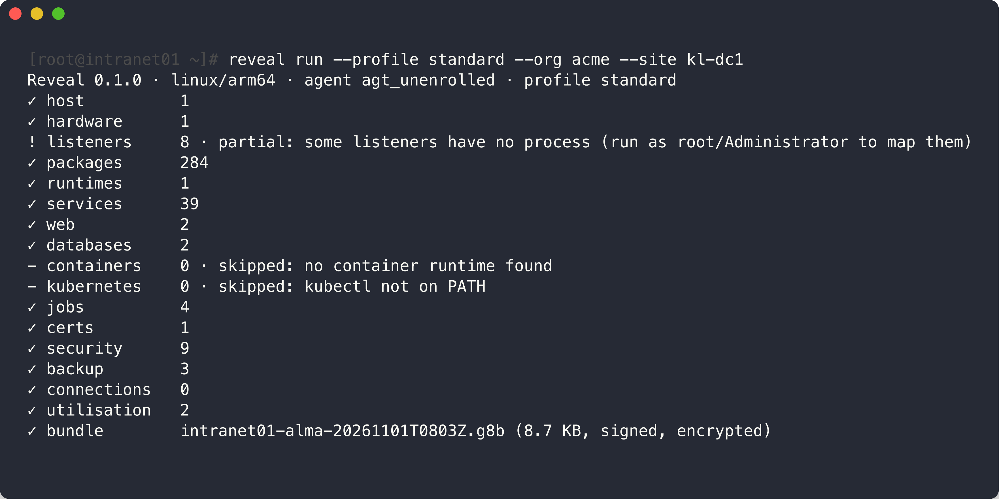
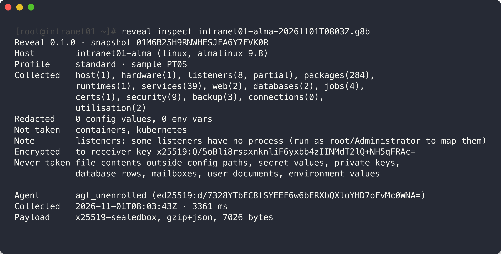

# G8Deck Reveal

Infrastructure discovery agent for IT assessments. One static binary inventories a host
(OS, hardware, packages, services, listeners, web servers, databases, containers,
scheduled jobs, certificates, utilisation, a read-only security baseline and backup
evidence) and seals the result into a signed, encrypted `.g8b` bundle for your assessor.

By **Developers Hub Sdn Bhd** · https://devhub.my · https://reveal.g8deck.com

This repo holds the compiled downloads only. Get them from **[Releases](https://github.com/developers-hub-my/reveal/releases/latest)**.

`reveal run` inventories the host and seals the result. Anything it cannot read is flagged, not hidden:



`reveal inspect` shows what a bundle holds before anyone uploads it:



<sub>Real output from Reveal 0.1.0 (Linux arm64) on a throwaway AlmaLinux 9 demo host, not a customer system.</sub>

## Downloads

| File | For |
|---|---|
| `reveal-<ver>-linux-amd64` | Linux x86-64 servers |
| `reveal-<ver>-linux-arm64` | Linux ARM servers (Graviton, Ampere) |
| `reveal-<ver>-linux-386` | Linux 32-bit |
| `reveal-<ver>-windows-amd64.exe` | Windows Server / Windows x64 |
| `reveal-<ver>-windows-386.exe` | Windows 32-bit |
| `reveal-<ver>-darwin-arm64` | macOS Apple Silicon |
| `reveal-<ver>-darwin-amd64` | macOS Intel |
| `reveal-<ver>-freebsd-amd64` | FreeBSD x86-64 |
| `reveal-<ver>-freebsd-arm64` | FreeBSD ARM |
| `SHA256SUMS` | Checksums |

Every binary is static: no runtime, no dependencies. Not sure which Linux build? `uname -m`
prints `x86_64` (use `amd64`) or `aarch64` (use `arm64`).

## Install

Linux server:

```sh
VER=0.1.0
curl -fLo reveal "https://github.com/developers-hub-my/reveal/releases/download/v$VER/reveal-$VER-linux-amd64"
sudo install -m 755 reveal /usr/local/bin/reveal
reveal version
```

Windows (PowerShell as Administrator):

```powershell
$VER = "0.1.0"
Invoke-WebRequest "https://github.com/developers-hub-my/reveal/releases/download/v$VER/reveal-$VER-windows-amd64.exe" -OutFile reveal.exe
.\reveal.exe version
```

The binaries are not code-signed yet: SmartScreen may warn on Windows (More info → Run
anyway), and on macOS run `xattr -d com.apple.quarantine reveal` once.

Check a download: `shasum -a 256 -c SHA256SUMS --ignore-missing`
(Windows: `Get-FileHash reveal.exe -Algorithm SHA256`).

## Run

Your assessor gives you either a receiver URL + token, or an enrollment pack file.

```sh
reveal run --dry-run                                                    # see what would be collected; writes and sends nothing
sudo reveal enroll --receiver https://receiver.example --token TOKEN   # or: --pack enrollment-pack.json
sudo reveal run --profile standard --sample 72h                         # sends to the receiver, falls back to a file
reveal inspect host-20261101T0915Z.g8b                                  # read the plaintext summary before uploading
```

Run as root / Administrator for complete results. Anything it cannot read is reported as
`partial` or `skipped` with the reason; the run does not fail.

## What it will and won't do

| Rule | How |
|---|---|
| Collect-only | Reads files and runs version/status commands. It accepts no commands from the receiver |
| Outbound-only | No listening port. The only network traffic is an HTTPS POST to your receiver |
| Redaction at source | Passwords in job commands and connection strings are replaced before anything is written |
| Encrypted | The payload is sealed to the receiver's public key; only the receiver can open it |
| Signed | Each host signs its bundle with a key generated locally that never leaves the host |
| Transparent | `summary.txt` in every bundle is plaintext, so your IT team can read it before upload |
| Never taken | File contents outside config paths, secret values, private keys, database rows, mailboxes, user documents, environment values |

Questions: hello@devhub.my

© 2026 Developers Hub Sdn Bhd. All rights reserved.
